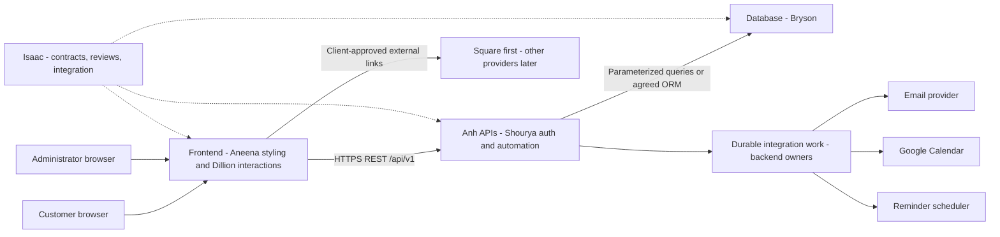

# Architecture and shared conventions

Status: proposed architecture for team review. Owner: Isaac Hernandez.
React/Vite, Flask and MySQL scaffolding was approved by Isaac on October 5, 2026.
Hosting, migration/model tooling, provider adapters and business rules remain open.

## Technology direction

Decision ADR-001: use React/Vite + Flask + MySQL for the shared scaffold, following
Isaac's explicit October 5 approval and the weekly plan's React/Flask tasks. The
research's AWS/Lambda/PostgreSQL proposal is an option review, not the chosen runtime.
AWS hosting services may still be evaluated later without changing this decision.

Exact frontend/Python dependency versions are recorded in `frontend/package-lock.json`
and `backend/requirements.txt`. Node 22 and Python 3.12 are the team/CI targets;
local compatibility checks used the available Node 25.9.0 and Python 3.9.6. CI target
execution is not yet verified. MySQL 8.4 is the proposed development family; pin a
reviewed production image/version with Bryson before release. Styling belongs to Aneena.

Isaac owns the application shell, factory, environment validation, health endpoints,
and local infrastructure configuration. Aneena/Dillion and Anh/Shourya own feature
components inside that foundation. Bryson owns schema/migrations/models; no domain
tables have been created by the shell. See [reference-alignment.md](reference-alignment.md)
and [database-integration-review.md](database-integration-review.md).

## Component boundaries

The browser never connects to MySQL or holds provider credentials. The backend is
authoritative for prices, validation, authorization, and payment verification.
Opening a payment link or returning from a provider page does not confirm a deposit.

## Folder ownership

Frontend/backend shells, docs, scripts and CI exist. Feature directories and the
database location below are proposed handoff locations; they do not contain domain code yet.

| Location | Intended contents | Owner |
| --- | --- | --- |
| `frontend/` | Existing Isaac shell; Aneena visual components and Dillion feature interactions | Isaac foundation; Aneena and Dillion features |
| `backend/` | Existing Isaac factory/config/health; Anh APIs and Shourya auth/automation | Isaac foundation; Anh and Shourya features |
| `backend/app/adapters/` | Proposed email/calendar adapters and agreed payment verification boundary | Shourya with Anh payment API |
| `database/` | ERD, migrations, seed guidance, recovery documentation | Bryson |
| `docs/` | Shared architecture, contracts, workflow, readiness | Isaac |
| `docs/api/` | Proposed OpenAPI specification and synthetic examples | Isaac with API owners |
| `.github/` | Review templates and shared build/contract/test CI | Isaac |
| `scripts/` and `compose.yaml` | Foundation checks and local DB infrastructure; no migrations | Isaac |

Bryson and the backend owners must agree on exactly one migration/model ownership
location. Do not create a second ORM model set or parallel migration history.

## REST boundary

- Version routes under `/api/v1` and use plural resource names.
- Use JSON, `snake_case` fields, opaque string identifiers, and ISO 8601 timestamps.
- Store timestamps as UTC; collect the event's IANA timezone separately.
- Use integer cents for money and an explicit currency. USD and `America/Chicago`
  are proposed defaults for this Houston business, pending client confirmation.
- Follow [api-contract.md](api-contract.md) for response envelopes and validation.
- Quote expiry, pagination caps, field lengths, and status enums are proposed
  technical limits, not confirmed client business rules.

## Persistence and external work

The backend owns orchestration. Bryson owns schema and migration design. Preserve
the accepted quote and price revision with an order so later price changes cannot
silently alter historical orders. The exact relational representation is Bryson's decision.

Commit an order and a durable record of required integration work before acknowledging
success. Agree on the transaction boundary with Bryson. Backend owners choose the
job runner or outbox mechanism; this document defines durability, not implementation.
Provider errors must leave the accepted order retrievable, with observable retry state.

Each order confirmation, business email, calendar event, and deposit-triggered
contract email needs a stable deduplication identity. Retries must reuse it. The
backend must reconcile ambiguous provider responses before sending another action.
Exactly-once delivery across third-party networks cannot be assumed.

## Environments and access

Development, staging, and production use separate databases, application secrets,
provider credentials, calendars, and recipient policies. Development integrations
start disabled. Staging uses synthetic customer data and approved test destinations.
Production changes require Isaac's release review and the user's deployment approval.

Prefer a same-origin HTTPS reverse proxy for the website and `/api/v1` in hosted
environments. If separate origins are chosen, configure an explicit allowlist and
the agreed credential mode. CORS is not authorization. See [configuration.md](configuration.md).

Application logs contain request IDs, safe error codes, and operational outcomes.
They exclude passwords, session/CSRF tokens, credentials, payment evidence, and
customer request bodies. Private identifiers and necessary audit detail belong in
access-controlled audit storage with an agreed retention policy.

## Interface change process

Contract changes require Isaac plus the affected frontend, backend, and database
owners to review examples and compatibility. Record the agreed version and update
both the Markdown guide and OpenAPI specification. Do not silently change field
meaning, money units, auth requirements, or status values.

For any teammate-owned feature change, explain why it is needed, name the owner,
describe the smallest patch, and identify impact before requesting approval.

## Week 4 acceptance boundary

The dated plan puts order/pricing/database integration on October 5-6, first staging
on October 7-8 and team demo on October 9. Shared health connectivity is not evidence
of these business flows. Order-created emails belong to Shourya in Week 4; Calendar
is Week 5; reminders and deposit-triggered contract delivery are Week 6. Their
interfaces may be prepared now without requiring future features for the first build.
